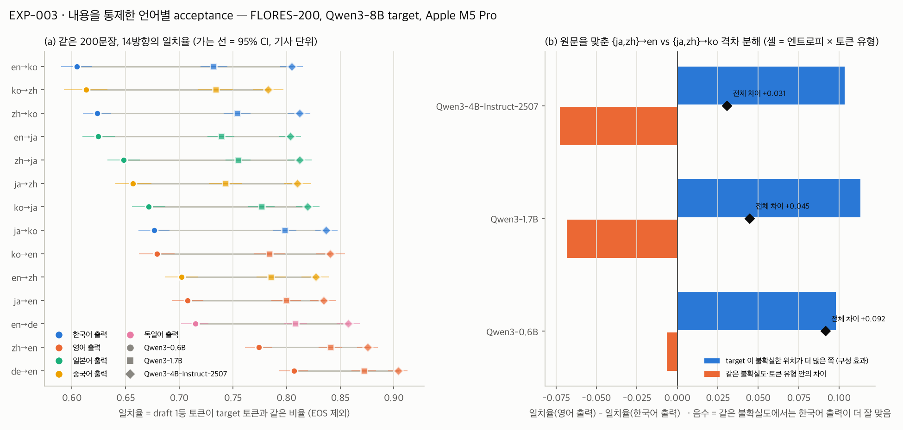
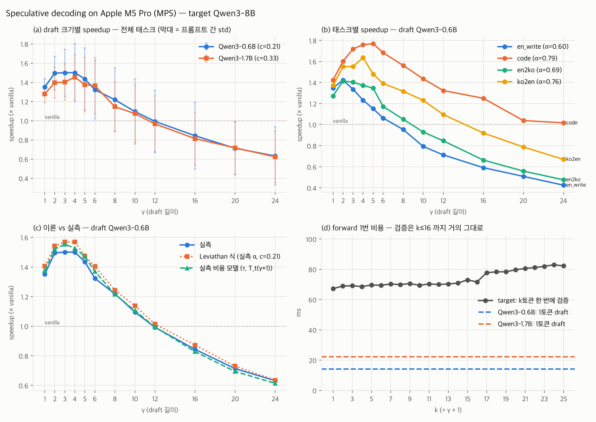

# 온디바이스AI-3팀 · Speculative Decoding

몰입심화학습(On-Device AI) 자유주제 연구 · ENC Lab · 박준하 · 박지호 · 양동균

**연구 주제** — 한국어 번역 task에서 speculative decoding의 acceptance rate와 latency가 draft-target 조합과 하드웨어 조건에 따라 어떻게 달라지는지 측정하고, 그 차이를 draft의 어휘 커버리지와 분포 정렬로 설명한다.

## 폴더

| 경로 | 내용 |
|---|---|
| [`spec-decode/`](spec-decode/) | Leviathan(ICML 2023) speculative decoding 직접 구현 + 속도 측정 코드, 실험 결과 |
| [`docs/W03-research-log.md`](docs/W03-research-log.md) | Week 03 연구 로그 — FLORES 언어 행렬 (EXP-003) |
| [`docs/W03-draft-yang-old.md`](docs/W03-draft-yang-old.md) | W03 측정 전 설계 초안 (양동균, 보존용 — 최종본은 위 W03 로그) |
| [`docs/W02-research-log.md`](docs/W02-research-log.md) | Week 02 연구 로그 (GitHub에서 바로 읽기) |
| [W03 연구 로그 웹페이지](https://junapark831.github.io/ondevice-ai-team3-specdecode/W03-research-log.html) | 같은 내용의 HTML 버전 (`docs/W03-research-log.html`, 구글 문서 복사 버튼) |
| [W02 연구 로그 웹페이지](https://junapark831.github.io/ondevice-ai-team3-specdecode/W02-research-log.html) | 같은 내용의 HTML 버전 (`docs/W02-research-log.html`) |

## W03 · 내용을 통제한 언어별 acceptance (FLORES-200, 14방향)

같은 FLORES-200 200문장을 en·ko·ja·zh 12방향 + en↔de 로 번역시키고, target 출력 위에서 draft 를 teacher forcing 해 모든 γ 의 SD 라운드를 재현했다 (실측 SD 와 α 0.005, speedup 0.075 안에서 일치).

| 출력 언어 (대표 방향) | 대표 방향의 일치율 ā · 0.6B / 1.7B / 4B-2507 | 실측 speedup γ=4 / γ=8 (0.6B, 그 출력 언어로 가는 모든 방향 평균) |
|---|---|---|
| 한국어 (en→ko) | 0.605 / 0.732 / 0.805 | 1.33 / 1.03 |
| 일본어 (en→ja) | 0.625 / 0.739 / 0.803 | 1.30 / 0.96 |
| 중국어 (en→zh) | 0.702 / 0.785 / 0.827 | 1.31 / 1.02 |
| 영어 (de→en) | 0.807 / 0.872 / 0.904 | 1.57 / 1.31 |

- 0.6B draft 에서 한국어 출력이 최저권이다 (en→ko 0.605 vs 같은 원문 en→de 0.715). 1.7B·4B 에서는 일본어 출력과 구별되지 않는다
- 원문을 맞춘 영어−한국어 출력 격차는 target 이 거의 확신하는 자리(엔트로피 < 0.05)의 비율 차이(74% vs 50%) 쪽에 몰려 있다 — 원인이 아니라 위치. 같은 확신도·토큰 유형에서는 0.6B 도 한국어를 덜 맞히지 않는다
- Qwen BPE 가 띄어쓰기 뒤 음절의 20% 를 바이트로 쪼개지만, 그 손해는 0.6B 한국어 일치율로 0.008 로 작다
- 실측 speedup(γ=4, 0.6B)은 한·일·중 출력 1.30~1.33× vs 영어 출력 1.57×. 비용 모델(같은 run 의 c)은 출력 언어별 0.075 안에서 맞는다
- H1 의 "연산 제약에 증폭"은 c 만 바꾼 외삽에서 비율로는 성립하지 않았다 (1.23 → 1.06)

자세한 내용은 [W03 연구 로그](docs/W03-research-log.md), 코드는 [`spec-decode/lang.py`](spec-decode/lang.py) · [`lang_plot.py`](spec-decode/lang_plot.py).

## W02 결과 (Apple M5 Pro 노트북)

Qwen3-8B target + Qwen3-0.6B / 1.7B draft, greedy, batch 1, 12프롬프트(en_write · code · en→ko · ko→en) × 2회.

| draft | c = T_draft / T_target | α | 최고 speedup | 역전 (speedup < 1) |
|---|---|---|---|---|
| Qwen3-0.6B | 0.21 | 0.69 | 1.50× (γ=4) | γ≈12 |
| Qwen3-1.7B | 0.33 | 0.79 | 1.45× (γ=4) | γ≈12 |

- 검증(target이 k토큰을 한 번에)은 k≤16까지 +9% 이내 → 역전을 만드는 건 draft 비용 γ·c
- c가 가중치 크기 비율의 2배: forward 1번 ≈ 7.8 ms 고정 오버헤드 + 바이트 / 259 GB/s
- 실측 α·c를 넣은 Leviathan 식이 역전 위치를 맞춘다 (모든 γ에서 실측과 0.01~0.08 차이)
- en→ko α(0.69)는 ko→en(0.76)보다 낮지만 영어 자유작문(0.60)보다 높다 — 원문 내용·토큰 길이 통제 전

자세한 수치는 [`spec-decode/results/combined/summary.md`](spec-decode/results/combined/summary.md), 해석과 경쟁 설명은 [W02 연구 로그](docs/W02-research-log.md).

## 재현

[`spec-decode/README.md`](spec-decode/README.md) 참고. 모델 가중치(약 20GB)와 가상환경은 저장소에 없다.
