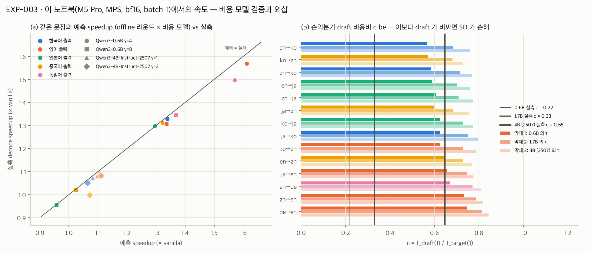

# Week 03 · 2026-10-16

ENC Lab · [온디바이스AI-3팀] 연구 로그 · 작성: 박준하 · 웹 버전 [W03-research-log.html](https://junapark831.github.io/ondevice-ai-team3-specdecode/W03-research-log.html) · 전체 수치 [`spec-decode/results/lang/summary.md`](../spec-decode/results/lang/summary.md)

## 현황판 갱신

| ID | 가설 (한 줄) | 상태 | 최근 갱신 |
|---|---|---|---|
| H1 | 같은 동양권인 일본어, 중국어에서는 acceptance rate가 크게 떨어지며 그 감소폭은 draft-target 어휘 커버리지로 예측되고 연산 제약이 강해질수록 증폭되는데 한국어에서도 발생할 것이다. (문장 수정 안건 — 아래) | 설계 중 → **검증 중** | W03 |
| H2 | 노트북(M5 Pro)에서 SD 역전 γ는 실측 α·c를 넣은 Leviathan 식 예측과 γ 격자 한 칸 이내로 일치한다. | 검증 중 | W03 |

## 한 줄 요약

같은 FLORES-200 200문장을 14방향으로 번역시키니 **0.6B draft에서 한국어 출력의 일치율이 최저권**이었다 (en→ko 0.605, 같은 원문 en→de 0.715, 차이 −0.110 [−0.126, −0.095]). 1.7B·4B draft에서는 한국어 출력이 일본어 출력과 구별되지 않는다. 실측 speedup(γ=4, 0.6B)은 한·일·중 출력이 1.30~1.33×로 비슷하고 영어 출력 1.57×보다 낮다. 원문을 맞춘 영어−한국어 출력 격차는 **target이 거의 확신하는 자리의 비율 차이(74% vs 50%)에 몰려 있다** — 원인이 아니라 위치다.

---

## H1. 한국어에서도 일본어·중국어처럼 α가 크게 떨어지고, 감소폭은 어휘 커버리지로 예측되며 연산 제약이 강해질수록 증폭된다 (박준하)

설계 중 → **검증 중** (처음으로 내용을 통제한 측정)

**경쟁 설명**

- C1. en→ko α가 낮은 게 원문 내용 차이 때문 → **배제.** 같은 문장 짝 en→ko − ko→en = −0.075 [−0.092, −0.058] (0.6B). W02의 −0.07은 다른 기사·옛 집계라 같은 양이 아니다 (이번 고친 α(γ=4)로는 −0.081)
- C2. 한국어 토큰이 잘게 쪼개져 생긴 차이 → **배제 실패 — 작은 몫으로 확인.** 띄어쓰기 뒤 음절의 20%가 바이트로 쪼개지고, 0.6B는 그 자리를 같은 확신도에서 0.15 덜 맞힌다 ([−0.22, −0.08]). 한국어 출력 일치율로는 약 0.008(격차의 1할 미만)이다. 1.7B는 줄지만 남고(전 구간 −0.040 [−0.069, −0.012]) 4B(2507)에서만 0과 구별되지 않는다
- C3. 언어가 아니라 출력 자유도(target 확신도)가 α를 정한다 → **배제 실패.** 원문을 맞춘 {ja,zh}→en vs {ja,zh}→ko 격차 +0.092는 거의 전부(엔트로피×토큰 유형으로 맞추면 π 1.07 [0.92, 1.26]) "target이 거의 확신하는 자리"(엔트로피 < 0.05 nats)의 비율 차이(74% vs 50%) 쪽에 있다. 같은 확신도·토큰 유형 안에서 0.6B는 한국어를 덜 맞히지 않는다 (−0.007 [−0.022, +0.008])
- C4. 원문에서 복사하는 이름·숫자, 한국어 출력에 섞인 한자 → **배제.** 빼도 en→ko − ko→en −0.066
- C5. FLORES는 영어 원문의 번역이라 X→en이 유리 → **배제 실패 (일부만 설명).** 일본어·중국어 원작 뉴스(WMT20)에서 zh 원문의 격차는 −0.151 → −0.118 [−0.139, −0.098]로 줄지만 남는다. ja 원문은 −0.005 [−0.027, +0.017]로 0과도 FLORES 값(−0.031)과도 구별되지 않고, WMT20 문장이 더 어려워(ja→en 0.708 → 0.622) 원문 언어 말고도 바뀐 것이 있다
- C6. 영어 지시문이라 한국어 출력 전 문맥에 한글이 없다 → **배제.** 한국어 지시문으로 다시 생성해도 en→ko −0.003, ko→en −0.006

**이번 주**

FLORES-200 devtest 200문장(150개 기사) × 14방향, Qwen3-8B target, greedy, CI = 기사 단위 부트스트랩. 실측 speedup은 방향마다 12문장 계획(드리프트 제외 후 8~12문장, 합계 155 run), M5 Pro·MPS·bf16·batch 1, 출력 언어별 평균. 진 조건부터.

| 출력 | 방향 (원문별) | 일치율 · 0.6B | 일치율 · 1.7B | 실측 speedup γ=4 / γ=8 (0.6B) |
|---|---|---|---|---|
| 한국어 | en / ja / zh → ko | 0.605 / 0.677 / 0.623 | 0.732 / 0.798 / 0.754 | 1.33 / 1.03 |
| 일본어 | en / ko / zh → ja | 0.625 / 0.672 / 0.648 | 0.739 / 0.777 / 0.755 | 1.30 / 0.96 |
| 중국어 | en / ko / ja → zh | 0.702 / 0.613 / 0.657 | 0.785 / 0.734 / 0.743 | 1.31 / 1.02 |
| 독일어 | en → de | 0.715 | 0.809 | 1.50 / 1.35 |
| 영어 | ko / ja / zh / de → en | 0.679 / 0.708 / 0.774 / 0.807 | 0.784 / 0.800 / 0.841 / 0.872 | 1.57 / 1.31 |

en→ko는 0.6B 점추정 최저지만 ko→zh와는 차이가 없다(−0.009 [−0.029, +0.013]). 1.7B에서 en→ko − en→ja는 −0.007 [−0.019, +0.005].

**Figure**

(a) 0.6B(●)에서는 한국어 출력(파랑)이 아래에 몰리지만, draft를 키우면(■, ◆) 일본어·중국어 출력과 섞인다. (b) 영어−한국어 격차(◆)는 파랑("target이 불확실한 위치가 더 많은 쪽")에 몰려 있고, 주황(같은 불확실도 안의 차이)은 0 근처이거나 음수다.

**해석**

0.6B에서 한국어 출력이 낮은 것은 같은 확신도·토큰 유형 안에서 draft가 한국어를 더 못 맞혀서가 아니다. 격차는 target이 확신하는 자리가 적은 쪽에 몰려 있다. target의 토큰당 놀람(−log p)이 한국어 출력에서 2.1~2.7배다. 이 분해는 격차의 위치를 보여 줄 뿐, target 확신도가 원인이라는 증거는 아니다. 한국어가 본래 예측하기 어려운지 Qwen이 한국어를 덜 잘하는지도 같은 계열 모델로는 가를 수 없다.

draft·target이 같은 어휘라 커버리지는 100%로 고정이다. 그래서 H1의 "커버리지로 예측"은 이번 실험으로 시험되지 않았다. 다른 계열 후보 토크나이저는 언어 간 폭이 넓어(EXAONE의 Qwen 출력 커버리지 ko 92% vs zh 29%) 다른 계열 draft 하나로 시험할 수 있다. 한국어 고유로 보이는 손실은 띄어쓰기 뒤 음절을 바이트로 쪼갠 자리지만, 일치율로 0.6B 약 0.008로 작다.

draft 크기를 바꾸면 이렇다. 0.6B → 1.7B → 4B(2507)로 바꾸면 영어−한국어 출력 격차가 logit으로 0.432 → 0.276 → 0.228로 준다 (P6 지지). 4B(2507)에서는 ko→zh가 단독 최저다 (en→ko보다 −0.022 [−0.037, −0.007]). 그러나 4B에서는 중국어 출력 효과가 가장 낮고 ko→ja가 en→ja보다 높아서, "한국어를 읽기"가 원인이라고는 아직 말할 수 없다. 원문 쪽 차이(0.6B ko→en이 zh→en보다 0.095, ja→en보다 0.028 낮음)도 출력 언어마다 순서가 달라 원문·출력 짝의 문제로 보인다 (탐색적).

H1의 "연산 제약이 강해질수록 증폭"은 c만 바꾼 외삽에서 비율로는 성립하지 않았다. 각자 최고 γ에서 영어/한국어 출력 속도 비가 c가 커질수록 1.23 → 1.06으로 준다 (0.6B). 손익분기 c_be는 γ=1 일치율 순서를 다시 쓴 것이고(c_be = τ(1) − r(2)), 1.7B·4B에서는 ko→zh가 먼저 닿는다. 그래서 대체 문장은 미팅에서 정한다.

**미보고**

- 어휘 커버리지 — 같은 토크나이저 쌍이라 H1 핵심 단어를 못 쟀다. 다른 계열 draft(EXAONE·Kanana)로 SD를 하려면 이종 어휘 알고리즘이 필요하다 (Timor 2025)
- "왜 target이 한국어에서 덜 확신하나" — 다른 계열 target이 필요하다
- draft 크기 축이 깨끗하지 않다 — 4B는 후처리 학습이 다른 판(Qwen3-4B-Instruct-2507)이다
- 다른 하드웨어 — 손익분기 c는 이 노트북의 검증 비용 곡선 위의 외삽이다

**논문 매핑**

K1의 X→En 비교를 출력 언어 쪽으로 확장 / Fig. 후보 — 14방향 일치율 + 격차 분해

---

## H2. 노트북(M5 Pro)에서 SD 역전 γ는 실측 α·c를 넣은 Leviathan 식 예측과 γ 격자 한 칸 이내로 일치한다 (박준하)

검증 중 (유지). 역전 γ는 이번에 재지 않았다 (실측은 0.6B γ=4·8, 4B γ=1·2). 같은 run에서 뽑은 c로 speedup 예측은 출력 언어별 0.075 안에서 맞았다.

**경쟁 설명**

- C1. 다른 프로세스 부하 → **배제 (재측정).** 첫 시도는 다른 세션의 메모리 압박으로 vanilla가 15 → 2 tok/s까지 떨어져 통째로 버렸다. 다시 돌린 run은 블록마다 앞뒤 vanilla와 swap-in을 기록했다. 첫 측정 168블록 중 10% 넘게 흔들린 39블록을 다시 쟀고, 재측정도 흔들린 13블록은 뺐다 (남은 run 155)
- C2. 예측과 실측이 같은 run의 시간에서 나와 맞을 수밖에 없다 → **배제 실패.** c(0.216, 0.645)를 검증한 online run 안에서 뽑았다. W02의 c(0.210)를 넣어도 0.6B 전체는 0.04 안에서 맞지만 독일어 출력은 0.09 높게 본다
- C3. 이 하드웨어·소프트웨어 스택에서만 맞는 것 → **미실시** (3090)

**이번 주**

- 실측 speedup(0.6B, 155 run씩) γ=4 **1.40** vs 예측 1.42, γ=8 **1.11** vs 1.12. 4B draft(c 0.645) γ=1 **1.08** vs 1.09, γ=2 **1.06** vs 1.09. 예측은 대체로 실측보다 조금 높다
- 같은 문장에서 offline 라운드 시뮬레이션 α와 실측 α의 차이 +0.001 (0.6B γ=4, 90% CI [−0.004, +0.004]), γ=8 +0.000. 84%(348/414)의 run은 라운드 단위까지 같다. 어긋난 66개 중 target 쪽 동점(t_ok=0)은 5개뿐이고, 나머지는 draft를 한 토큰씩 계산할 때와 한꺼번에 계산할 때의 bf16 차이로 draft 1등이 바뀐 것으로 보인다
- **sd.py 집계 버그를 고쳤다.** EOS 뒤 토큰까지 수락·거절로 세고 있었다. 생성과 시간 측정은 그대로라 W02 speedup은 유효하다. EOS로 끝난 번역 태스크의 α만 영향을 받는다 (이번 데이터로 옛 집계를 재현하면 0.6B γ=4 α 0.664 → 고친 집계 0.679)
- 샘플링 SD(T=0.7) 실측 α가 그 출력 위에서 teacher forcing으로 계산한 1−TV 기대값과 약 0.01 이내로 맞았다 (한국어 0.612 vs 0.605, 영어 0.728 vs 0.732)

**Figure**

(a) 점이 대각선 근처에 있다 = 같은 run의 c로 예측한 speedup이 출력 언어별로 0.075 안에서 맞는다. (b) 0.6B의 τ로 외삽하면 en→ko가 가장 먼저 손익분기에 닿지만 ko→zh와 0.005 차이이고, 1.7B·4B의 τ로는 ko→zh(중국어 출력)가 먼저 닿는다.

**해석**

W02의 비용 모델 τ·T_t(1)/(γ·T_d + T_t(γ+1))은 문장 길이·언어가 다른 입력에서도, draft가 다른 c 0.65에서도 같은 run의 c를 넣으면 맞는다. 그래서 언어별 속도 차이를 τ 차이로 옮겨 말할 수 있다. 4B는 α가 높아도(γ=1 0.87) c가 0.65라 실측 1.06~1.08×로 0.6B(γ=4 1.40×)보다 낮다. "draft를 키워 α를 올리는 것은 이 노트북에서 손해"라는 W02 관찰과 같은 방향이다 (draft 비용을 줄이는 쪽은 이번에 재지 않았다).

**미보고**

- 역전 γ — 이번에 재지 않았다 (H2 문장의 대상)
- 독립적인 c로 예측 — 같은 날 따로 잰 c는 부하로 흔들렸다 (0.6B 0.18 vs run 안 0.216)
- 3090

**논문 매핑**

Leviathan (ICML 2023) 속도 식 + 검증 비용 곡선 / Fig. 후보 — 같은 문장 예측 vs 실측

---

## 미팅 결정사항

*미팅 중 입력.*

## 선행연구 · 막힌 것

- **H1 문장** — "연산 제약에 증폭"은 c만 바꾼 외삽에서 비율로는 성립하지 않았다(1.23 → 1.06). 대체 문장을 정해야 한다. "커버리지로 예측"은 다른 계열 draft로 언어 간 비교를 하기 전까지 미검증으로 둔다
- 다른 계열 draft(EXAONE·Kanana·HyperCLOVAX)로 이종 어휘 SD를 범위에 넣을지 — Kanana-1.5는 Llama-3 토크나이저를 그대로 쓴다 (커버리지 표: `spec-decode/results/lang/coverage.md`)
- 3090 사용 일정 — H2 C3, 역전 γ와 c 실측
